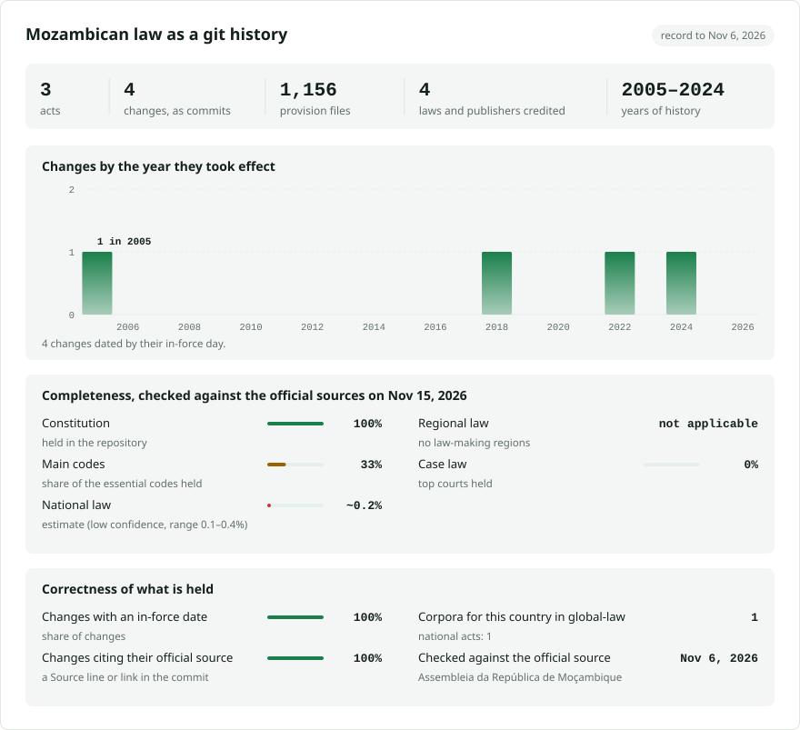

# Mozambique: law history in git

[Português](README.md) · **English**

<picture>
<source media="(prefers-color-scheme: dark)" srcset="data/effort-dark.svg">

</picture>

The law of Mozambique as a git history: one file per article, one commit per version on the day it took effect, and the act that made each change as the commit's author. `git blame` names the act behind every paragraph; `git log` lists every change to an article; picking a date gives the text in force that day.

Part of [lexifina/global-law](https://github.com/lexifina/global-law), one git history for every country's law: this is Mozambique's national law, which global-law reads at `mozambique/national/acts/`.

**What is in it now:** the Constitution (Constituição da República de Moçambique) in three versions: the 2004 text, in force from 21 January 2005; its Article 304 as replaced by Lei n.º 26/2007, from 16 November 2007; and the text revised and republished by Lei n.º 1/2018, from 12 June 2018. The codes in `codigos/codigo-comercial/`, and the Lei do Trabalho (Lei n.º 13/2023) in `leis/2023/013-lei-do-trabalho/`. And, as published in the Boletim da República (1972–2026), 164 decrees, 158 ministerial diplomas, 102 resolutions, 60 laws, 6 presidential decrees, 4 decree-laws, 1 portaria, 1 international agreement and 1 notice, each in `<type>/<year>/<number>-<subject>/`. The layout is in [STRUCTURE.md](STRUCTURE.md).

Each act is a folder, one file per article and a `preambulo.md`: `leis/2023/013-lei-do-trabalho/art-108.md` is Article 108 (Duração do período de férias) of the Lei do Trabalho, and the decree-law's own articles are `codigos/codigo-comercial/dl-art-NNN.md`. The 2018 revision renumbered most articles of the Constitution from Article 140 on, so after 12 June 2018 a file holds the article that now bears its number.

The text is in Portuguese, as the Assembleia da República's editions and the Boletim da República print it. An English translation is not part of this record.

## Questions as git commands

| Question | Command |
| --- | --- |
| Every change to Article 108 of the Lei do Trabalho (annual leave) | `git log -p --word-diff -- leis/2023/013-lei-do-trabalho/art-108.md` |
| Which act wrote each paragraph of Article 108? | `git blame leis/2023/013-lei-do-trabalho/art-108.md` |
| Every version of Article 108, with the day each took effect | `git log --format="%h %(trailers:key=In-force,valueonly,separator=) %an" -- leis/2023/013-lei-do-trabalho/art-108.md` |
| Article 108 as in force on 1 January 2025 | `python tools/on.py 2025-01-01 leis/2023/013-lei-do-trabalho 108` |

**Outside git**, we also host this record publicly, for free:

- **[Ask Claude about Mozambican law](https://global-law.lexifina.com/v1/try_claude?country=mozambique)**: opens Claude with a first question ready.
- **[Ask ChatGPT](https://global-law.lexifina.com/v1/try_chatgpt?country=mozambique)**: the same question in ChatGPT.
- **[Search Mozambican law on our site](https://lexifina.com/law?country=mozambique&q=f%C3%A9rias)**: a search for "férias" (annual leave), with each provision's text and its versions, no account needed.
- **[Developer REST API](https://global-law.lexifina.com/v1/search_law?query=f%C3%A9rias&jurisdiction=mozambique)**: the same search as JSON, with no key. See the [documentation here](https://lexifina.com/api/global-law).

Both assistants read the record through the free Global law connector (MCP, `https://global-law.lexifina.com/mcp`); the first time, the chat gives you the link that adds it. Ask in Portuguese or in English.

**Host it yourself easily.** All it takes is git and Python, and the tools run on your machine:

```sh
git clone --depth 1 https://github.com/lexifina/global-law && cd global-law
python3 tools/countries.py add mozambique/national/acts
python3 tools/law.py show 2026-01-01 mozambique/national/acts/leis/2023/013-lei-do-trabalho/art-108.md
```

Opened in Claude Code, Cursor, VS Code or Codex, the clone also starts a local MCP server with the same tools ([MCP.md](https://github.com/lexifina/global-law/blob/main/MCP.md)).

## Dates

Each commit is dated at noon, Africa/Maputo, on the day the version took effect, and carries it in its `In-force:` trailer:

- the 2004 Constitution took effect on 21 January 2005, the day after the 2004 general election results were validated and proclaimed (its art. 306), as the Conselho Constitucional states; Lei n.º 26/2007 on its publication, 16 November 2007 (its art. 2); Lei n.º 1/2018 on 12 June 2018, the day it was published;
- the Código Comercial took effect 120 days and the Lei do Trabalho 180 days after publication (25 May 2022 and 25 August 2023; decree-law art. 8 and law art. 274), counted from the next day: 22 September 2022 and 21 February 2024;
- the 2007 version was found after the others were published, so it is a later `Kind: correction` commit, which `tools/on.py` applies from 16 November 2007 to 11 June 2018. Ask for a date with `tools/on.py`, not `git log --before`.

The first version of the Constitution is credited to the Constitution as approved on 16 November 2004, and Lei n.º 1/2018 to every article that differs in 2018, renumbering included; each code is credited whole to the act that enacted it. The 2007 correction, and the one that sets Article 304 back to its 2018 text, are credited to Lexifina (their messages name the law), so `git blame constituicao/art-304.md` names Lexifina. The committer is always Lexifina.

## How it is checked

- `tools/check_repo.py` reads every version back from git on the day it took effect and on the day before, and both must match the corpus: 5 versions of 3 acts, 0 mismatches. The results are in [`REPRODUCE.md`](REPRODUCE.md).
- The texts are read from the PDFs' own text layers, not scans. Every article of the 2004 and 2018 Constitution was compared, character for character, with a second, independent extraction of the same PDFs, and every paragraph of the two codes was found, in order, in one. The 2007 article is read from the one-page official scan and checked word for word against the whole page.
- History is append-only: no merge commits, no commit dated after the build, and every commit's trailers parse.
- [vulnerabilities/](vulnerabilities/README.en.md): possible drafting mistakes in this law, found by global-law's detectors and checked by hand. Not run yet.

## What it does not show

- **The 2023 revision of Article 311(3)** (district elections; approved 3 August 2023, promulgated 4 August 2023): no law number, Boletim da República issue or copy with a text layer was found, so `constituicao/art-311.md` still reads "têm lugar no ano de 2024", which is no longer the law.
- **Later amendments to the two codes.** The Código Comercial and the Lei do Trabalho are the texts as enacted; no amendment is applied.
- **Acts not yet collected**: those published only as scans without a text layer (we do no OCR), those with no datable entry-into-force clause, and the Código Civil (no consolidated Mozambican text with a text layer); see STRUCTURE.md.
- **Headings and formulas.** Title, chapter and section headings and the closing approval and signature formulas are not files; each article file starts with its number and heading.
- **Texts published only as scans**, such as the official republication of 2018 (Boletim da República, I Série n.º 115, 2.º suplemento); the one-page Lei n.º 26/2007 is the only scan read.

## Sources

| Source | Kind | Past versions | Notes |
| --- | --- | --- | --- |
| Assembleia da República: [Constituição da República](https://www.parlamento.mz/wp-content/uploads/2022/06/Constituicao-da-Republica.pdf) (2004) and [*Legislação Básica*](https://www.parlamento.mz/wp-content/uploads/2022/08/Legislacao_Basica.pdf) (2022) | Official editions, born-digital PDFs | yes, the 2004 text and the text as revised in 2018 | The Constitution's versions of 2005 and 2018 |
| Boletim da República (Imprensa Nacional), I Série n.º 99, 25 May 2022, copy published by the [Banco de Moçambique](https://bancomoc.mz/media/q4kh3wop/decreto-lei-1-2022_25-de-maio_c%C3%B3digo-comercial.pdf) | Official gazette, born-digital PDF | no, the act as enacted | Decreto-Lei n.º 1/2022 and the Código Comercial |
| Boletim da República, I Série n.º 165, 2.º suplemento, 25 August 2023, copy held by [FAOLEX](https://faolex.fao.org/docs/pdf/moz221728.pdf) | Official gazette, born-digital PDF | no, the act as enacted | Lei n.º 13/2023, the Lei do Trabalho |
| [Conselho Constitucional](https://cconstitucional.org.mz/historial/) | Constitutional court: the Constitution's history, and the gazette scan of [Lei n.º 26/2007](https://cconstitucional.org.mz/wp-content/uploads/2023/12/Lei26-2007de16deNovembroalteraoartigo304daConstituicaodaRepublica.pdf) | one change, of 2007 | The day the 2004 Constitution took effect; the 2007 text of Article 304 |
| [WIPO Lex](https://www.wipo.int/wipolex/en/legislation/details/21389) | Legislation database | no | The dates of Lei n.º 1/2018 |

## Licence

See [`LICENSE`](LICENSE). The texts are official legislative texts, which Mozambique's copyright law leaves unprotected (Lei n.º 9/2022, art. 7(1)(a)), reproduced with the attribution LICENSE gives. The history, commit messages, tables and tools are CC0 1.0.

No AI model wrote, translated or corrected legal text, and none runs when the history is built; the scripts were written by AI models, Claude and, for the 2007 version, GPT-6, which also compared its OCR with the official scan (see [`REPRODUCE.md`](REPRODUCE.md)).

## Visualisations

- [visualisations/](visualisations/README.en.md): charts drawn from this repository. Not drawn yet.

## More

From [lexifina/global-law](https://github.com/lexifina/global-law):

- [FEATURES.md](https://github.com/lexifina/global-law/blob/main/FEATURES.md): every feature, and what every corpus must support (`git blame`, `law.py`, the MCP tools)
- [FAQ.md](https://github.com/lexifina/global-law/blob/main/FAQ.md): questions and answers · [CONTRIBUTING.md](https://github.com/lexifina/global-law/blob/main/CONTRIBUTING.md): proposing changes · [MCP.md](https://github.com/lexifina/global-law/blob/main/MCP.md): the MCP server · [REPRODUCE.md](https://github.com/lexifina/global-law/blob/main/REPRODUCE.md): how it was built · [CHANGELOG.md](https://github.com/lexifina/global-law/blob/main/CHANGELOG.md)
- [FRESHNESS.md](https://github.com/lexifina/global-law/blob/main/FRESHNESS.md): how current each corpus is · [Monitoring](https://github.com/lexifina/global-law/tree/main/monitoring): whether updates are running · [WATCHING.md](https://github.com/lexifina/global-law/blob/main/WATCHING.md): how each official source is watched for changes
- [performance/](https://github.com/lexifina/global-law/tree/main/performance): how fast the tools are, measured
- [visualisations/](https://github.com/lexifina/global-law/tree/main/visualisations): charts and bridges across the world's law
- [Vulnerabilities](https://github.com/lexifina/global-law/tree/main/vulnerabilities): mistakes in legislation as published
