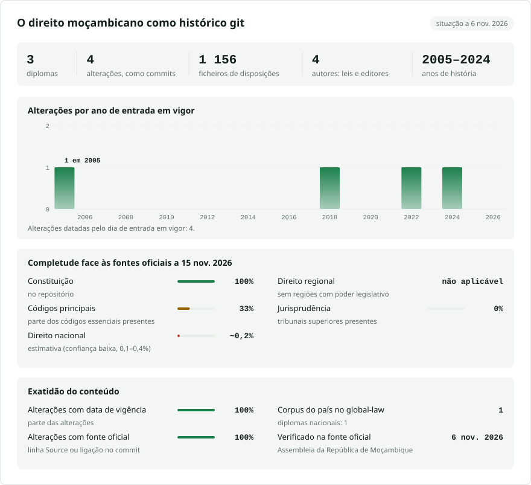

# Moçambique: a história do direito em git

**Português** · [English](README.en.md)

<picture>
<source media="(prefers-color-scheme: dark)" srcset="data/pt/effort-dark.svg">

</picture>

O direito de Moçambique como uma história git: um ficheiro por artigo, um commit por versão no dia em que entrou em vigor e, como autor do commit, o ato que fez cada alteração. `git blame` indica o ato por detrás de cada parágrafo; `git log` lista todas as alterações a um artigo; escolhendo uma data, obtém-se o texto em vigor nesse dia.

Faz parte de [lexifina/global-law](https://github.com/lexifina/global-law), uma única história git do direito de todos os países: este é o direito nacional de Moçambique, que o global-law lê em `mozambique/national/acts/`.

**O que contém por agora:** a Constituição (Constituição da República de Moçambique) em três versões: o texto de 2004, em vigor desde 21 de janeiro de 2005; o seu artigo 304 tal como substituído pela Lei n.º 26/2007, desde 16 de novembro de 2007; e o texto revisto e republicado pela Lei n.º 1/2018, desde 12 de junho de 2018. Os códigos em `codigos/codigo-comercial/`, e a Lei do Trabalho (Lei n.º 13/2023) em `leis/2023/013-lei-do-trabalho/`. E, tal como publicados no Boletim da República (1972–2024), 62 decretos, 49 diplomas ministeriais, 27 leis, 22 resoluções, 2 decretos presidenciais, 1 portaria e 1 acordo internacional, cada um em `<tipo>/<ano>/<número>-<objecto>/`. A organização está em [STRUCTURE.md](STRUCTURE.md).

Cada ato é uma pasta, com um ficheiro por artigo e um `preambulo.md`: `leis/2023/013-lei-do-trabalho/art-108.md` é o artigo 108 (Duração do período de férias) da Lei do Trabalho, e os artigos do próprio decreto-lei são `codigos/codigo-comercial/dl-art-NNN.md`. A revisão de 2018 renumerou a maior parte dos artigos da Constituição a partir do artigo 140, pelo que, a partir de 12 de junho de 2018, cada ficheiro contém o artigo que passou a ter esse número.

O texto está em português, tal como as edições da Assembleia da República e o Boletim da República o publicam. Não faz parte deste registo nenhuma tradução inglesa.

## Perguntas como comandos git

| Pergunta | Comando |
| --- | --- |
| Todas as alterações ao artigo 108 da Lei do Trabalho (férias) | `git log -p --word-diff -- leis/2023/013-lei-do-trabalho/art-108.md` |
| Que ato escreveu cada parágrafo do artigo 108? | `git blame leis/2023/013-lei-do-trabalho/art-108.md` |
| Todas as versões do artigo 108, com o dia em que cada uma entrou em vigor | `git log --format="%h %(trailers:key=In-force,valueonly,separator=) %an" -- leis/2023/013-lei-do-trabalho/art-108.md` |
| O artigo 108 em vigor em 1 de janeiro de 2025 | `python tools/on.py 2025-01-01 leis/2023/013-lei-do-trabalho 108` |

**Fora do git**, também disponibilizamos este registo publicamente e de forma gratuita:

- **[Perguntar ao Claude sobre o direito moçambicano](https://global-law.lexifina.com/v1/try_claude?country=mozambique)**: abre o Claude com uma primeira pergunta já preparada.
- **[Perguntar ao ChatGPT](https://global-law.lexifina.com/v1/try_chatgpt?country=mozambique)**: a mesma pergunta no ChatGPT.
- **[Pesquisar o direito moçambicano no nosso sítio](https://lexifina.com/law?country=mozambique&q=f%C3%A9rias)**: uma pesquisa por "férias", com o texto de cada disposição e as suas versões, sem necessidade de conta.
- **[API REST para programadores](https://global-law.lexifina.com/v1/search_law?query=f%C3%A9rias&jurisdiction=mozambique)**: a mesma pesquisa em JSON, sem chave. Veja a [documentação aqui](https://lexifina.com/api/global-law).

Ambos os assistentes leem o registo através do conector gratuito Global law (MCP, `https://global-law.lexifina.com/mcp`); da primeira vez, a conversa dá-lhe a ligação que o adiciona. Pergunte em português ou em inglês.

**Aloje-o facilmente por conta própria.** Basta ter git e Python, e as ferramentas correm na sua máquina:

```sh
git clone --depth 1 https://github.com/lexifina/global-law && cd global-law
python3 tools/countries.py add mozambique/national/acts
python3 tools/law.py show 2026-01-01 mozambique/national/acts/leis/2023/013-lei-do-trabalho/art-108.md
```

Aberto no Claude Code, no Cursor, no VS Code ou no Codex, o clone inicia também um servidor MCP local com as mesmas ferramentas ([MCP.md](https://github.com/lexifina/global-law/blob/main/MCP.md)).

## Datas

Cada commit tem a data do meio-dia, hora de Africa/Maputo, do dia em que a versão entrou em vigor, e indica-a no seu trailer `In-force:`:

- a Constituição de 2004 entrou em vigor em 21 de janeiro de 2005, o dia seguinte à validação e proclamação dos resultados das eleições gerais de 2004 (o seu art. 306), como indica o Conselho Constitucional; a Lei n.º 26/2007 na data da sua publicação, 16 de novembro de 2007 (o seu art. 2); a Lei n.º 1/2018 em 12 de junho de 2018, o dia em que foi publicada;
- o Código Comercial entrou em vigor 120 dias e a Lei do Trabalho 180 dias após a publicação (25 de maio de 2022 e 25 de agosto de 2023; art. 8 do decreto-lei e art. 274 da lei), contados a partir do dia seguinte: 22 de setembro de 2022 e 21 de fevereiro de 2024;
- a versão de 2007 foi encontrada depois de as outras terem sido publicadas, pelo que é um commit posterior `Kind: correction`, que `tools/on.py` aplica de 16 de novembro de 2007 a 11 de junho de 2018. Consulte uma data com `tools/on.py`, não com `git log --before`.

A primeira versão da Constituição é atribuída à Constituição tal como aprovada em 16 de novembro de 2004, e a Lei n.º 1/2018 a todos os artigos que diferem em 2018, incluindo a renumeração; cada código é atribuído por inteiro ao ato que o aprovou. A correção de 2007, e a que repõe o artigo 304 no seu texto de 2018, são atribuídas à Lexifina (as suas mensagens indicam a lei), pelo que `git blame constituicao/art-304.md` indica a Lexifina. O committer é sempre a Lexifina.

## Como é verificado

- `tools/check_repo.py` relê a partir do git cada versão no dia em que entrou em vigor e no dia anterior, e ambas têm de coincidir com o corpus: 5 versões de 3 atos, 0 divergências. Os resultados estão em [`REPRODUCE.md`](REPRODUCE.md).
- Os textos são lidos das próprias camadas de texto dos PDF, não de digitalizações. Cada artigo da Constituição de 2004 e de 2018 foi comparado, carácter a carácter, com uma segunda extração independente dos mesmos PDF, e cada parágrafo dos dois códigos foi encontrado, pela ordem, numa delas. O artigo de 2007 é lido da digitalização oficial de uma página e verificado palavra a palavra com a página inteira.
- A história só cresce por acréscimo: sem commits de fusão (merge), sem nenhum commit com data posterior à construção, e os trailers de todos os commits são legíveis.
- [vulnerabilities/](vulnerabilities/): possíveis erros de redação neste direito, encontrados pelos detetores do global-law e verificados à mão. Ainda não executado.

## O que não mostra

- **A revisão de 2023 do n.º 3 do artigo 311** (eleições distritais; aprovada em 3 de agosto de 2023, promulgada em 4 de agosto de 2023): não foi encontrado o número da lei, o número do Boletim da República nem uma cópia com camada de texto, pelo que `constituicao/art-311.md` continua a dizer "têm lugar no ano de 2024", o que já não é o direito em vigor.
- **Alterações posteriores aos dois códigos.** O Código Comercial e a Lei do Trabalho são os textos tal como aprovados; nenhuma alteração está aplicada.
- **Os atos ainda não recolhidos**: os que só existem em digitalizações sem camada de texto (não fazemos OCR), os que não têm norma de entrada em vigor datável e o Código Civil (não há texto moçambicano consolidado com camada de texto); a lista está em STRUCTURE.md.
- **Epígrafes e fórmulas.** As epígrafes dos títulos, capítulos e secções e as fórmulas finais de aprovação e assinatura não são ficheiros; cada ficheiro de artigo começa com o seu número e epígrafe.
- **Textos publicados apenas como digitalizações**, como a republicação oficial de 2018 (Boletim da República, I Série n.º 115, 2.º suplemento); a Lei n.º 26/2007, de uma página, é a única digitalização lida.

## Fontes

| Fonte | Tipo | Versões anteriores | Notas |
| --- | --- | --- | --- |
| Assembleia da República: [Constituição da República](https://www.parlamento.mz/wp-content/uploads/2022/06/Constituicao-da-Republica.pdf) (2004) e [*Legislação Básica*](https://www.parlamento.mz/wp-content/uploads/2022/08/Legislacao_Basica.pdf) (2022) | Edições oficiais, PDF nativamente digitais | sim, o texto de 2004 e o texto revisto em 2018 | As versões da Constituição de 2005 e de 2018 |
| Boletim da República (Imprensa Nacional), I Série n.º 99, de 25 de maio de 2022, cópia publicada pelo [Banco de Moçambique](https://bancomoc.mz/media/q4kh3wop/decreto-lei-1-2022_25-de-maio_c%C3%B3digo-comercial.pdf) | Jornal oficial, PDF nativamente digital | não, o ato tal como aprovado | O Decreto-Lei n.º 1/2022 e o Código Comercial |
| Boletim da República, I Série n.º 165, 2.º suplemento, de 25 de agosto de 2023, cópia conservada pela [FAOLEX](https://faolex.fao.org/docs/pdf/moz221728.pdf) | Jornal oficial, PDF nativamente digital | não, o ato tal como aprovado | A Lei n.º 13/2023, Lei do Trabalho |
| [Conselho Constitucional](https://cconstitucional.org.mz/historial/) | Tribunal constitucional: a história da Constituição e a digitalização do jornal oficial com a [Lei n.º 26/2007](https://cconstitucional.org.mz/wp-content/uploads/2023/12/Lei26-2007de16deNovembroalteraoartigo304daConstituicaodaRepublica.pdf) | uma alteração, de 2007 | O dia em que a Constituição de 2004 entrou em vigor; o texto de 2007 do artigo 304 |
| [WIPO Lex](https://www.wipo.int/wipolex/en/legislation/details/21389) | Base de dados de legislação | não | As datas da Lei n.º 1/2018 |

## Licença

Veja [`LICENSE`](LICENSE). Os textos são textos legislativos oficiais, que a lei moçambicana do direito de autor deixa sem proteção (Lei n.º 9/2022, art. 7, n.º 1, alínea a)), reproduzidos com a atribuição indicada no LICENSE. A história, as mensagens de commit, as tabelas e as ferramentas estão sob CC0 1.0.

Nenhum modelo de IA escreveu, traduziu ou corrigiu texto jurídico, e nenhum é executado quando a história é construída; os scripts foram escritos por modelos de IA, o Claude e, para a versão de 2007, o GPT-6, que também comparou o seu OCR com a digitalização oficial (veja [`REPRODUCE.md`](REPRODUCE.md)).

Esta é uma tradução da versão inglesa ([README.en.md](README.en.md)); em caso de divergência, prevalece a versão inglesa.

## Visualizações

- [visualisations/](visualisations/): gráficos feitos a partir deste repositório. Ainda não feitos.

## Mais informação

Do repositório [lexifina/global-law](https://github.com/lexifina/global-law) (páginas em inglês):

- [FEATURES.md](https://github.com/lexifina/global-law/blob/main/FEATURES.md): todas as funcionalidades e o que cada corpus tem de suportar (`git blame`, `law.py`, ferramentas MCP)
- [FAQ.md](https://github.com/lexifina/global-law/blob/main/FAQ.md): perguntas e respostas · [CONTRIBUTING.md](https://github.com/lexifina/global-law/blob/main/CONTRIBUTING.md): propor alterações · [MCP.md](https://github.com/lexifina/global-law/blob/main/MCP.md): servidor MCP · [REPRODUCE.md](https://github.com/lexifina/global-law/blob/main/REPRODUCE.md): como foi construído · [CHANGELOG.md](https://github.com/lexifina/global-law/blob/main/CHANGELOG.md)
- [FRESHNESS.md](https://github.com/lexifina/global-law/blob/main/FRESHNESS.md): quão atualizado está cada corpus · [Monitorização](https://github.com/lexifina/global-law/tree/main/monitoring): se as atualizações estão a funcionar · [WATCHING.md](https://github.com/lexifina/global-law/blob/main/WATCHING.md): como cada fonte oficial é vigiada para detetar alterações
- [performance/](https://github.com/lexifina/global-law/tree/main/performance): a rapidez das ferramentas, medida
- [visualisations/](https://github.com/lexifina/global-law/tree/main/visualisations): gráficos e ligações através do direito de todo o mundo
- [Vulnerabilidades](https://github.com/lexifina/global-law/tree/main/vulnerabilities): erros nos diplomas tal como foram publicados
